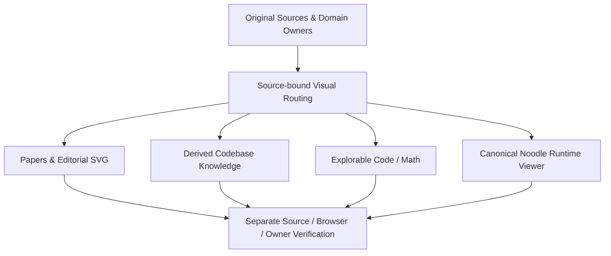

# Unified Visual Architecture — medium-compiler

**Scope:** ARC-01 A (one coherent routing/source/acceptance contract, phased features) and ARC-02 A (medium-compiler is the first codebase-analysis target). The previously selected ViewEnv Q1–Q36, VIZ-01 A / 02 A / 03 A / 04 A and VIS-06 B / 07 B / 08 A / 09 A / 10 A / 11 A / 12 A / 13 A / 14 A (DuckDB amendment) / 15 A / 16 A / 17 A are preserved. This page indexes existing owners; it does **not** create a new truth owner, state machine, prompt schema, mandatory skill chain or product acceptance.

## One source-bound routing question

Choose the presentation from **(1) source type and owner, (2) desired reader operation, (3) required fidelity/rights and disclosure, (4) target medium, (5) independent acceptance**. An illustration, a learning simulation, a static architecture hypothesis, and an observed Agent event have different truth conditions. Do not coerce all four into one generic causal Graph object.

The original producer issues a source revision / exact content; the consumer verifies source references before projecting a diagram. Design-time skill selection is advisory and only records a candidate until it is actually invoked. Every visualization stays **derived**, with original source identity and omissions disclosed. A rendered green line is not a source observation.

## Explanatory overview (not a native execution trace)

This graph depicts documentation and renderer selection, **not observed task handoffs**. Line direction denotes a presentation/verification dependency only, and never grants a Native Event or CLI next.

## Domain routes — producer → projection → consumer

| Reader intent | Source / truth owner | Presentation producer and owner | Consumer | Independent verification / current ceiling |
| --- | --- | --- | --- | --- |
| Native Agent Execution / Actual–Expected–Hypothesis | Original Soodles task/Owner and Noodle Host; original Graph v2 and native receipts | Pinned Noodle `loop-panorama.mjs` and `site/loop-graph-layout.mjs`; medium-compiler only adapts published graph | Isolated TanStack `/panorama`; existing public `/loops` | Original IDs/edges, artifact byte/digest, browser interactions. **Native Agent/whole-goal acceptance NOT_RUN** on this PR |
| Public Runtime Evidence / Recorded Replay | Original reviewed public Snapshot Publisher; not this viewer | `scripts/loop_graph_site.py` content-addressed package and `apps/loop-workbench/src/public-artifact.mjs` reader | Source-bound inspector, no Host calls | Exact same-origin snapshot and `content_urls` + SHA-256 + byte-length. Browser fixtures **tested**, genuine new owner-bound replay **NOT_RUN** |
| Codebase architecture / hierarchical source navigation | Exact medium-compiler checkout and file references | Optional pinned oh-my-mermaid `omm-scan`/`omm-view` to provisional `.omm` candidate; reviewed projection belongs under `docs/derived-architecture/` | Versioned architecture explanations and Mermaid references | Pinned MIT source installed in isolated CI; semantic full-repo OMM scan, independent approval and publication **NOT_RUN**. No cloud push |
| Editorial teaching flowchart / architecture explainer | Approved article/source, original Content Owner | Optional SeeCode JSON spec → isolated HTML candidate / approved SVG; `beautiful-mermaid` for simpler Mermaid→SVG candidate | Article figure or isolated interactive preview | SeeCode CLI and Chromium step/focus/screenshot **tested with fixture**; real article publication and source-loss approval **NOT_RUN** |
| Paper/research figure | Published paper and authorized figure rights; paper/source author decides claim | Source-approved static SVG; PaperBanana is an **isolated research reference only** | Paper reader / article method figure | Semantic claim-to-figure parity, visual/rights review **NOT_RUN** for new paper figures; no PaperBanana product workflow |
| Research Evals explanation | Original evaluation/test/trace/metric owners, not a diagram | Existing `scripts/ai_evals_site.py` and article builder; explanatory diagrams optional | Existing AI Evals articles; future Claim→Method→Trace→Metric viewer | Source article/build checks separately from independent evals. New interactive Evals Evidence Explorer **NOT_IMPLEMENTED** |
| Explorable math and code teaching | Authored exercise/original mathematical operation and its test Oracle | React teaching UI; source-bound calculations/figures; distill-style probes are methods, not a truth owner | Isolated `/learning` Preview | Two authored Python exercises and local draft storage exist; actual arbitrary Pyodide runner and browser grader **GATED/NOT_ACCEPTED** |
| Learning progress and local analytics | Local browser learner only; never Native Agent Owner | DuckDB-Wasm OPFS `learning-store.ts`, user-supplied export; native DuckDB CLI Agent Mode as read-only offline consumer | `/learning` and separately installed CLI | Chromium write→reopen and JSON/.duckdb export **tested**; mobile Safari, repeated OPFS stability, real DuckDB CLI v2 **NOT_RUN** |
| Typed Code Explorer | Authoritative repository/compiler/schema, with measured runtime values only if available | Planned source-bound TypeScript/Schema view, no generic LLM type guessing | Proposed code-understanding view | **NOT_IMPLEMENTED**; do not claim Hover/Type runtime verification |

**No second Graph Truth Owner:** SeeCode editorial simplifications and OMM inferred dependency maps cannot become original Graph v2 causal nodes or change a Native acceptance status. Original Soodles/Noodle contracts always take precedence over a source-only illustration.

## Exact Producer → Consumer handoffs

1. **Runtime/public:** Original Owner admits a run and produces original event/evidence. The disclosure-reviewed exporter (`docs/public-loop-graph.md`) validates Graph v2, strips private bodies, publishes `graph.json` and independently stored content-addressed `artifacts/<sha256>.txt`. Only the existing Noodle geometry reads the graph; `readReviewedArtifact` fetches only same-origin, exact path and original reviewed digest/bytes. Rejected/private/missing content stays UNKNOWN; no original Owner effect API is exposed.
2. **Article/figure:** Source-owning writer accepts canonical Markdown; `scripts/build_site.py` uses `scripts/article_diagrams.py` and `references/article-diagrams.json` to replace only a source-bound, review-approved Mermaid fence with an IMG link to digest-verified SVG. `tools/article-diagrams` and SeeCode are isolated authoring candidates. New SVG images require actual visual/source review before being entered into the registry. ALG Four paragraph/English bindings and canonical article bytes are unchanged.
3. **Architecture knowledge:** Read only actual code at pinned medium-compiler revision; an authorized design-time OMM scan proposes perspective, hierarchy, Mermaid and explanatory Markdown. Review original file:line references and diagram's inferred/deleted/merged elements; obtain independent review before committing versioned content. Do not scan Soodles/Noodle/NeoWeaver from this route, and do not install or invoke `omm-push`. The `design/diagram-candidates/manifest.json` currently contains **zero approved candidates**. Installing source SKILL files is not an executed scan.
4. **Learning/computation:** Authoritative exercises precede any teaching simulation. A computation may be declared executed only after the real isolated runner returns test observations. DuckDB OPFS owns local untrusted learner records, not Python execution or a trusted score. Exporting data to CLI is an explicit user action; browser cannot invoke DuckDB CLI Agent Mode or inherit Host authority.

## Design language and choice discipline

- **Presentation reference:** Anthropic `html-effectiveness` (editorial hierarchy, HTML/CSS/SVG, inspector patterns), not a copied production runtime. The existing Static Site and isolated TanStack Start shell remain separate deployment systems.
- **Source-side methodology:** OpenAI Node-Link/UML/visual testing Skills, Cursor Sasha Rush `pydiagrams` / Tensor teaching, Distill-style interaction probes; reference only until individually vetted for a specific task. No unapproved dependencies.
- **Existing selected skills:** `loop-visual-design` routes Taste to public editorial, Anatomy to explanatory isometry, Impeccable to operational information hierarchy, Emil to motion audit. SeeCode is editorial authoring, OMM is derived source analysis. Use the narrowest needed skill; none automatically executes on every token/Agent step.
- **Renderer ownership:** `beautiful-mermaid` emits approved build-time SVG candidates; SeeCode emits reviewed editorial options; Noodle retains executable Graph presentation. Do not replace geometry just to change color/theme.
- **Accessibility/UX:** desktop/mobile keyboard, reduced motion, readable focus, contrast, meaningful alt text and graceful fallback must be tested on the actual chosen surface; unsupported Mermaid syntax cannot be guessed into a new factual claim.
- **Commercial rights:** MIT/Apache and other permissive code licenses apply only to the pinned corresponding files. Brand assets, fonts, CDN encoders, academic papers and potentially patented research methods require separate provenance and approval. Keep generated SeeCode HTML on an isolated Origin with default system fonts and blocked external network.

## Verification map (separate oracles, not a universal PASS)

| Layer | Evidence required | What PASS does not prove |
| --- | --- | --- |
| Source/rights | Exact upstream refs, valid LICENSE, source SHA and disclosure review | Original source accuracy, third-party paper/figure rights |
| Shape/layout | Renderer invoked; node/edge and loss report; screenshot / semantic comparison | Executed native handoffs, non-observed dependencies |
| Interaction/browser | Actual Chromium desktop/mobile, keyboard/step/inspector, external-request refusal | General Safari stability, reader comprehension, Native Agent outcome |
| Computation/learning | Actual Python/JS execution with a bounded independent test, OPFS readback | Server-trusted grading, cross-user results, ML mastery |
| Original Native/runtime | Original producer/consumer identity, independent verifier and exact receipt | Production release merely from a UI test |
| Provider/deployment | Authorized exact-main deployment and external readback | Permissions to deploy from Draft PR; correctness of unobserved tasks |

## Verified baseline and outstanding gaps

For the **preceding** PR #72 source head `ae0cef3b284d109cc14ec0c46ab3531a7fd525e7`, [Loop Workbench Contract](https://github.com/ed3c/medium-compiler/actions/runs/39556095581) and [Writing Verification](https://github.com/ed3c/medium-compiler/actions/runs/39556096586) both completed successfully. The fixture SeeCode CLI produced 4 nodes, 3 edges, 7 presentation steps, and real Chromium exercised stepping and inspector. Those receipts are **not** for this document's future commit head; run new exact-head CI separately.

Remaining blockers are genuine OMM scan/review, reviewed new article/paper SVG, Pyodide sandbox and grader, Typed Code Explorer, live NeoWeaver/native acceptance, independent reader understanding, mobile Safari persistence, exact-head Production Provider readback. Treat independent unknowns separately. PR #72 remains Draft and no Production deploy/merge is authorized here.

## Thinking Route decision and stop

ARC-01 A / ARC-02 A are the only new choices. Follow [Soodles Thinking Router](https://github.com/ed3c/soodles/blob/main/.agents/skills/thinking-router/SKILL.md): original Goal / Measurement / Effort Horizon, check the first source-bound causal mismatch, use bounded adversarial reasoning only to change an engineering decision, then preserve the existing authorized next. **PromptDelta = focused router/docs reconciliation**; there is no second Owner, new P-class gate, fabricated digest or unbounded dual-brain loop. No new material Scope/Owner/rights question remains. Do not ask again.
